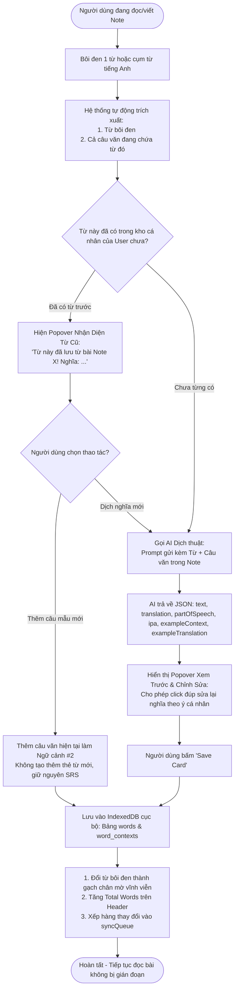
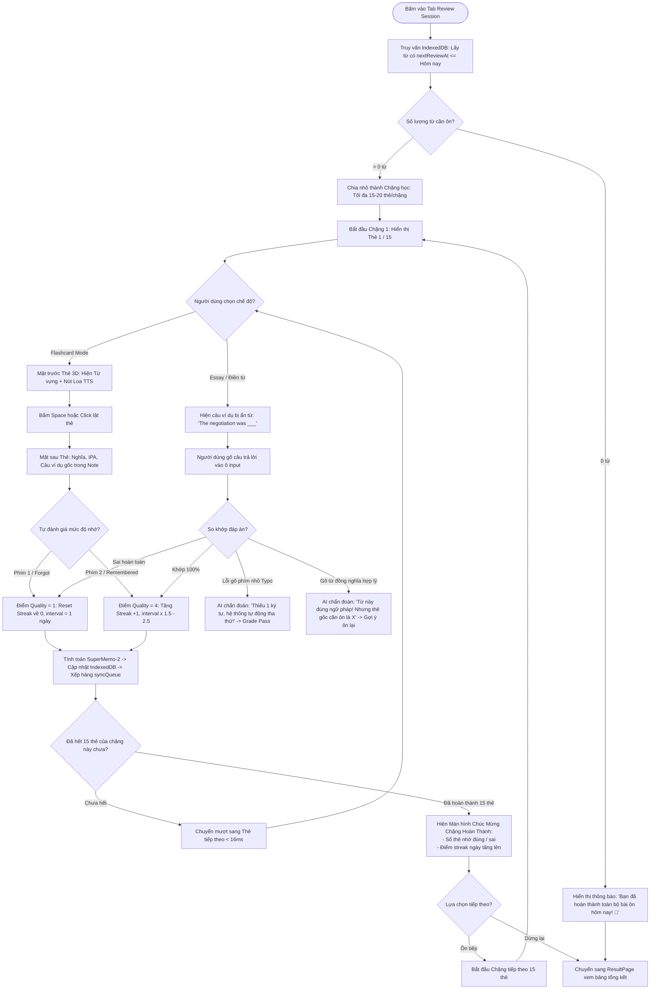
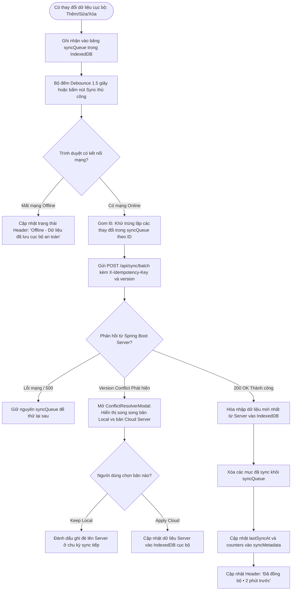

# TÀI LIỆU TRẢI NGHIỆM NGƯỜI DÙNG NÂNG CẤP (UX_new.md)

## Dự án: Hệ Thống Học Từ Vựng Tiếng Anh Ghi Chú Thông Minh (Smart English Notes - Redesign)

---

## 1. Định Vị & Triết Lý Trải Nghiệm Mới

- **Khái niệm cốt lõi**: _"Editorial Notebook meets High-Performance Spaced Repetition"_ — Sự giao thoa giữa không gian ghi chép bài đọc tĩnh lặng, sâu sắc kiểu Notion/Craft và cỗ máy ôn tập từ vựng siêu tốc, mượt mà kiểu Linear/SuperMemo.
- **Nguyên tắc trải nghiệm**:
  1. **Tôn trọng dòng chảy suy nghĩ (Unbroken Flow State)**: Việc đọc bài và bôi đen dịch từ không bao giờ làm gián đoạn việc đọc.
  2. **Ngữ cảnh hóa tối đa (Context-Driven Learning)**: Một từ vựng không sống cô lập; nó gắn chặt với câu văn, bài viết và cảm xúc của người đọc lúc lưu từ.
  3. **Không gây ngợp (Paced & Humane SRS)**: Thay vì áp lực 200 từ quá hạn, hệ thống chia nhỏ thành các chặng học ngắn tạo cảm giác chinh phục nhẹ nhàng.
  4. **Giữ nguyên 100% tính năng hiện hữu và mở rộng tự nhiên**.

---

## 2. Bảo Toàn & Kế Thừa Tính Năng Hiện Có (Preserved Baseline)

Mọi tính năng nền tảng trong phiên bản cũ đều được giữ nguyên và tinh chỉnh logic:

- ✅ Kiến trúc **Offline-First** (lưu trữ IndexedDB, dùng tốt khi mất mạng hoàn toàn).
- ✅ Người dùng **tự cấu hình API Key cá nhân** (DeepSeek hoặc Google Gemini) bảo mật.
- ✅ Hệ thống đồng bộ hàng loạt (**Batch Sync**) kèm hộp thoại giải quyết xung đột (**Conflict Resolver**).
- ✅ Cây thư mục **Topics $\rightarrow$ Notes** linh hoạt.
- ✅ Thuật toán **Spaced Repetition SuperMemo-2** với chu kỳ ngày tăng dần và phân loại trạng thái: `NEW` $\rightarrow$ `LEARNING` $\rightarrow$ `TEMP_REMEMBERED` $\rightarrow$ `MASTERED`.
- ✅ Hai chế độ học: **Lật thẻ Flashcards** và **Gõ kiểm tra chính tả/đặt câu (Essay Test)**.

---

## 3. Bản Đồ Cấu Trúc Tabs & Cây Tính Năng Toàn Dự Án (Feature & Tab Architecture Map)

Sơ đồ dưới đây cấu trúc toàn bộ các Màn hình (Views), Thanh điều hướng (Tabs), Bảng điều khiển (Panels) và Tính năng (Features) để AI và Designer nắm bắt trọn vẹn kiến trúc hệ thống:

```mermaid
graph TD
    App[Toàn bộ Ứng dụng Smart English Notes]

    %% Các Views cấp cao nhất
    App --> AuthView[1. LoginPage / AuthPage]
    App --> MainView[2. MainPage - Không gian làm việc chính]
    App --> SettingsView[3. KeySettingPage - Cấu hình Khóa AI]
    App --> TestView[4. TestPage - Phòng Ôn tập Chuyên sâu]
    App --> ResultView[5. ResultPage - Thống kê & Kho từ vựng]
    App --> ConflictModal[6. ConflictResolverModal - Hộp thoại xung đột]

    %% Chi tiết AuthView
    AuthView --> Auth_Login[Tab Sign In: Username + Password]
    AuthView --> Auth_Register[Tab Sign Up: Username + Email + Password]
    AuthView --> Auth_JWT[Stateless JWT Session Storage]

    %% Chi tiết MainView Bố cục 3 phần
    MainView --> HeaderNav[Header: DashboardCounters]
    MainView --> SideNav[Sidebar Trái: Leftbar]
    MainView --> CenterWorkspace[Khu vực Trung tâm: Tab Switcher]

    %% Header Items
    HeaderNav --> H_Brand[App Logo & Tên dự án]
    HeaderNav --> H_SyncPill[Chỉ báo Sync: Connected / Syncing / Offline]
    HeaderNav --> H_Stats[Thống kê nhanh: Today's Streak + Total Words]
    HeaderNav --> H_Tabs[Bộ chuyển Tab: Word Editor vs Review Session]

    %% Sidebar Items
    SideNav --> S_Topics[Quản lý Topics: Thêm mới, Xóa, Thu gọn/Mở rộng]
    SideNav --> S_Notes[Quản lý Notes: Danh sách bài viết, Tạo bài mới, Đếm số từ harvest]
    SideNav --> S_User[User Footer: Avatar, Settings ⚙️, Theme Switcher, Đăng xuất]

    %% Center Workspace Tabs
    CenterWorkspace --> Tab_Editor[Tab 1: Word Editor - NotionEditor]
    CenterWorkspace --> Tab_Quiz[Tab 2: Review Session - QuizEngine]

    %% Tính năng trong Tab Editor
    Tab_Editor --> E_Title[Soạn thảo Tiêu đề]
    Tab_Editor --> E_Content[Soạn thảo Nội dung Văn bản Đa dòng]
    Tab_Editor --> E_Highlight[Highlight vĩnh viễn các từ đã lưu + Tooltip nghĩa]
    Tab_Editor --> E_AI_Popover[Popover AI Dịch từ khi Bôi đen]
    E_AI_Popover --> E_ContextExtract[Tự động bóc tách Câu văn chứa từ trong Note]
    E_AI_Popover --> E_Dedup[Nhận diện từ cũ: Gợi ý thêm câu mẫu thứ 2]
    E_AI_Popover --> E_PreSave[Popover chỉnh sửa nghĩa bằng tay trước khi Lưu]

    %% Tính năng trong Tab Quiz
    Tab_Quiz --> Q_Paced[Chia chặng học: 15-20 thẻ/lần]
    Tab_Quiz --> Q_Flashcard[Chế độ 1: Thẻ lật 3D xúc giác + Audio TTS + Phím tắt]
    Tab_Quiz --> Q_Essay[Chế độ 2: Điền từ chính tả + AI chẩn đoán lỗi typo/đồng nghĩa]
    Tab_Quiz --> Q_SM2[Thuật toán SuperMemo-2: Tính nextReviewAt, intervalDays, streak]
    Tab_Quiz --> Q_Victory[Màn hình Hoàn thành chặng: Học tiếp hoặc Xem kết quả]

    %% Chi tiết ResultView
    ResultView --> R_Bento[Bento Grid: Thống kê số từ nạp mới, số lượt đã ôn, Tỷ lệ nhớ]
    ResultView --> R_Streak[Biểu đồ chuỗi ngày học liên tục Streak]
    ResultView --> R_Table[Bảng tra cứu Kho từ vựng: Tìm kiếm, Lọc trạng thái, Xem đa ngữ cảnh]

    %% Chi tiết SettingsView
    SettingsView --> Set_Provider[Chọn Provider: DeepSeek vs Google Gemini]
    SettingsView --> Set_Test[Nút Test Connection: Kiểm tra tính hợp lệ của Key]
    SettingsView --> Set_Models[2 Dropdown chọn Model: Dịch thuật vs Chấm bài tập]
    SettingsView --> Set_AES[Mã hóa AES-256 lưu trữ Backend an toàn]

    %% Chi tiết ConflictModal
    ConflictModal --> C_Diff[So sánh song song 2 cột: Local Version vs Cloud Version]
    ConflictModal --> C_Action[Lựa chọn: Giữ bản máy này hoặc Ghi đè từ đám mây]
```

---

## 4. Sơ Đồ Luồng Thực Hiện Từng Tính Năng Cốt Lõi (Detailed Feature Flowcharts)

Dưới đây là 3 luồng thực hiện tính năng chi tiết từ hành động của người dùng đến xử lý dữ liệu và phản hồi giao diện:

### 4.1. Luồng 1: Bôi đen Dịch & Thu thập Đa Ngữ cảnh (`NotionEditor`)

---

### 4.2. Luồng 2: Ôn tập Lặp lại Ngắt quãng theo Chặng (`QuizEngine`)

---

### 4.3. Luồng 3: Đồng bộ Đa Thiết bị & Giải quyết Xung đột (`SyncManager`)

---

## 5. Tóm Tắt Nâng Cấp UX Từng Màn Hình

### 5.1. Trang Chủ & Trình Soạn Thảo (`NotionEditor` & `MainPage`)

- **Trích xuất Ngữ cảnh Tự động**: Bôi đen từ vựng $\rightarrow$ tự động trích xuất cả câu văn chứa từ đó gửi cho AI.
- **Nhận diện Từ cũ Tức thì (Instant Recognition)**: Báo từ đã tồn tại, cho phép bấm _"Thêm câu văn này làm câu mẫu thứ 2"_ để làm giàu ngữ cảnh mà không nhân bản thẻ.
- **Popover Xem & Tùy Chỉnh trước khi Lưu**: Cho phép click đúp sửa nhanh nghĩa tiếng Việt theo ý hiểu cá nhân trước khi nhấn Save Card.
- **Highlight vĩnh viễn trong bài viết**: Gạch chân chấm thanh nhã các từ đã lưu, rê chuột hiển thị nghĩa nhanh.

### 5.2. Trang Ôn Tập Thẻ Từ (`QuizEngine` & `TestPage`)

- **Chia Chặng Học Nhỏ (Paced Sessions)**: 15–20 thẻ/chặng, giải phóng áp lực ngợp bài, có màn hình Micro-Victory tiếp thêm động lực.
- **Thẻ Flashcard Xúc Giác 3D**: Lật thẻ xoay không gian 3D mượt mà, hỗ trợ trọn vẹn phím tắt (`[Space]`, `[1]`, `[2]`).
- **AI Chẩn Đoán Lỗi trong Điền từ**: Nhận diện lỗi typo gõ thiếu chữ và từ đồng nghĩa ngữ cảnh thay vì chấm sai cứng nhắc.

### 5.3. Trang Tổng Kết & Tra Cứu Kho Từ Vựng (`ResultPage`)

- **Bento Grid Thống Kê**: Phân biệt rành mạch số từ nạp mới hôm nay và số lượt thẻ đã ôn tập, đo lường tỷ lệ chính xác.
- **Quản lý Đa Ngữ Cảnh**: Danh sách từ vựng hiển thị số lượng câu ví dụ (`3 câu ví dụ`), click mở rộng xem lại các bài Note mà từ đó từng xuất hiện.

### 5.4. Đồng Bộ & Quản Lý Phiên (`SyncManager` & `AuthPage`)

- **Đồng bộ Ngầm Yên Tĩnh**: Thay thế nút quay giật bằng chỉ báo thời gian mờ nhã nhặn.
- **Đăng xuất Êm Ái**: Xóa token và dữ liệu IndexedDB an toàn, chuyển trang mượt mà không dùng `location.reload()`.

---

## 6. Ma Trận So Sánh Tính Năng Cũ vs Mới

| Luồng Nghiệp Vụ                 | Phiên Bản Hiện Tại (UX_old)                                  | Phiên Bản Nâng Cấp (UX_new)                                                                  |
| :------------------------------ | :----------------------------------------------------------- | :------------------------------------------------------------------------------------------- |
| **Bôi đen dịch trong Note**     | Dịch từ đơn lập, tự động lưu ngay, gây trùng lặp từ cũ.      | Dịch kèm câu văn ngữ cảnh, nhận diện từ cũ để thêm câu mẫu mới, cho phép sửa trước khi lưu.  |
| **Ôn tập hàng ngày (SRS)**      | Đổ toàn bộ hàng trăm từ cùng lúc, gây áp lực ngợp.           | Chia nhỏ thành các chặng 15-20 từ/phiên, hỗ trợ phím tắt, hiệu ứng hoàn thành tạo động lực.  |
| **Chấm điểm kiểm tra chính tả** | So sánh chuỗi cứng `===`, sai 1 ký tự là coi như quên từ.    | AI chẩn đoán lỗi typo, phân biệt từ đồng nghĩa ngữ cảnh và giải thích lỗi sai thân thiện.    |
| **Báo cáo kết quả**             | Tính số liệu dựa trên timestamp ngày cập nhật (dễ sai lệch). | Ghi log lịch sử ôn tập riêng, hiển thị chuẩn xác số từ nạp mới và số lượt ôn tập trong ngày. |
| **Đa ngữ cảnh của từ**          | 1 từ gắn chết với 1 Note duy nhất.                           | 1 từ cá nhân có thể tích lũy nhiều câu mẫu từ nhiều bài Note khác nhau.                      |
| **Kiến trúc Sơ đồ Diagrams**    | Không có sơ đồ phân cấp.                                     | Cung cấp đầy đủ Sơ đồ Cây tính năng & 3 Sơ đồ Luồng chi tiết.                                |
