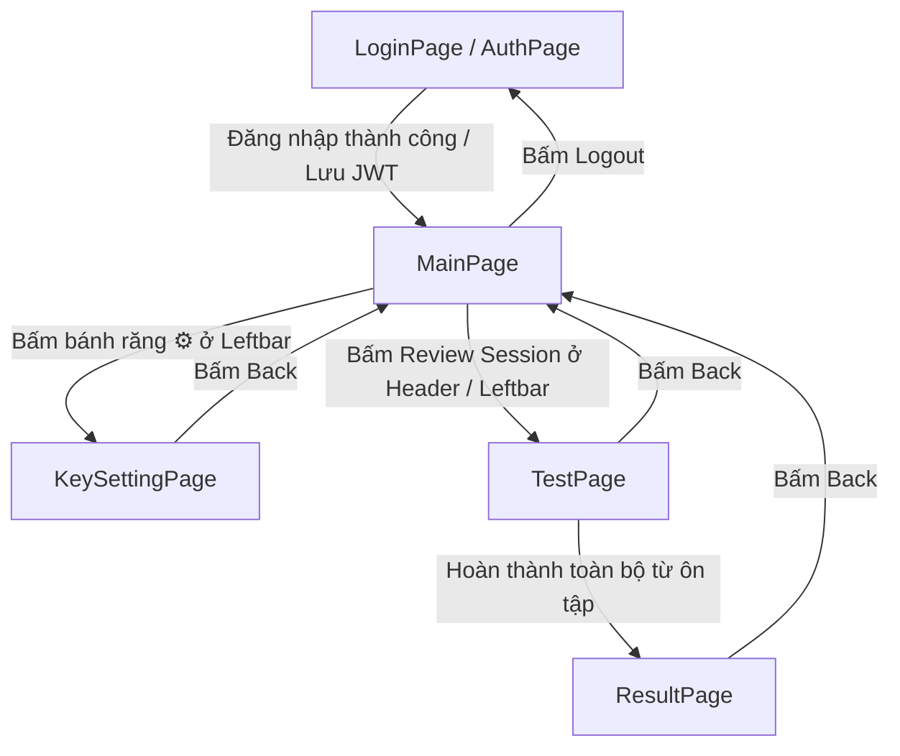

# TÀI LIỆU TRẢI NGHIỆM NGƯỜI DÙNG HIỆN TẠI (UX_old.md)

## Dự án: Hệ Thống Học Từ Vựng Tiếng Anh Ghi Chú Thông Minh (Smart English Notes)

---

## 1. Tổng quan & Triết lý Thiết kế Hiện tại

Ứng dụng kết hợp giữa **Soạn thảo ghi chú kiểu Notion (Notion-style note-taking)** và **Ôn tập lặp lại ngắt quãng (Spaced Repetition System - SRS)** theo mô hình **Offline-First (ưu tiên ngoại tuyến)**. Dữ liệu học tập được lưu cục bộ trên trình duyệt qua IndexedDB (Dexie.js) và đồng bộ hàng loạt (Batch Sync) với Spring Boot Backend khi có mạng.

---

## 2. Kiến trúc Luồng Người dùng Hiện tại (User Journey Map)

Ứng dụng hiện tại là Single Page Application (SPA) điều hướng bằng state `activeView` tại `app/page.tsx`:

---

## 3. Hành trình Người dùng Chi tiết Theo Từng Màn Hình

### 3.1. Trang Xác thực (LoginPage / AuthPage)

- **Mục đích**: Đăng nhập (`login`) hoặc Đăng ký (`register`) tài khoản học tập.
- **Luồng UX**:
  1. Người dùng thấy form căn giữa màn hình tối (`bg-slate-950`), hộp thoại viền mỏng (`border-slate-800`).
  2. Chọn tab: **Sign In** (Username + Password) hoặc **Sign Up** (Username + Email + Password).
  3. Bấm Submit:
     - Thành công: Lưu `jwt_token`, `user_role`, `username` vào `localStorage`, chuyển ngay vào `MainPage`.
     - Thất bại: Hiển thị hộp thông báo lỗi màu đỏ (`border-rose-500/20 bg-rose-500/10 text-rose-400`).
- **Hành vi phiên**: Không có cơ chế Remember Me hay Social Login; chỉ dùng JWT lưu trong `localStorage`.

---

### 3.2. Trang Chủ & Soạn thảo (MainPage)

Bố cục chia 3 khu vực:

1. **Header trên cùng (`DashboardCounters`)**:
   - Hiển thị logo, nút bấm **Sync**, 2 tab chuyển đổi (**Word Editor** vs **Review Session**).
   - 2 pill thống kê: **Today's Streak** (`dailyWordCount`) và **Total Words** (`totalWordCount`).
   - Huy hiệu trạng thái mạng: **Connected** (Xanh lá) hoặc **Offline** (Vàng hổ phách).
2. **Thanh bên trái (`Leftbar`)**:
   - Cây thư mục **Topics (Chủ đề)**: Thêm chủ đề mới, mở rộng/thu gọn danh sách bài viết.
   - Danh sách **Notes (Ghi chú)** thuộc từng Topic: Click để mở bài viết, bấm nút `+` để tạo bài mới.
   - Chân trang Leftbar: Hiển thị tên user, nút mở `KeySettingPage` (⚙️), nút chuyển Theme (Sáng/Tối/Màu nhấn), và nút **Log Out**.
3. **Khu vực trung tâm (`NotionEditor`)**:
   - Ô nhập **Tiêu đề bài viết** (`title`).
   - Khung soạn thảo **Nội dung bài viết** (`textarea` đa dòng).
   - **Thao tác Bôi đen Dịch từ bằng AI**:
     - Người dùng bôi đen từ/cụm từ tiếng Anh $\rightarrow$ xuất hiện Popover nổi nhỏ mang nút **"Translate with AI"** (biểu tượng Sparkles ✦).
     - Bấm nút $\rightarrow$ Khung loading xoay tròn hiển thị: _"AI is generating vocabulary card..."_.
     - AI trả về JSON $\rightarrow$ Tự động lưu thẳng thẻ từ vựng vào bảng `words` của IndexedDB với trạng thái `NEW`.
     - Hiện thông báo nhỏ góc phải dưới: _"Saved to Dictionary"_ với chi tiết Từ vựng, Loại từ, Nghĩa tiếng Việt, và phiên âm IPA.

---

### 3.3. Trang Cấu hình Khóa AI (KeySettingPage)

- **Mục đích**: Người dùng tự cấu hình API Key cá nhân để sử dụng dịch vụ AI.
- **Luồng UX**:
  1. Màn hình toàn trang với nút Back ở góc trái.
  2. Chọn 1 trong 2 nhà cung cấp AI:
     - **DeepSeek**: Thẻ chọn viền Cyan.
     - **Google Gemini**: Thẻ chọn viền Tím/Hồng.
  3. Nhập API Key (có icon con mắt ẩn/hiện mật khẩu).
  4. Bấm **Test Connection**: Gọi trực tiếp endpoint của nhà cung cấp để kiểm tra tính hợp lệ của key.
  5. Nếu key hợp lệ: Hệ thống tự động lấy danh sách Model và hiển thị 2 dropdown:
     - **Translation Model**: Model chuyên dùng dịch từ bôi đen trong bài viết.
     - **Quiz Model**: Model chuyên dùng chấm điểm bài tập chính tả.
  6. Bấm **Save Configuration**: Gửi key mã hóa lên backend lưu trữ an toàn.

---

### 3.4. Trang Luyện tập Ôn bài (TestPage / QuizEngine)

- **Mục đích**: Ôn tập các từ vựng đến hạn hôm nay theo thuật toán lặp lại ngắt quãng SuperMemo-2.
- **Luồng UX**:
  1. Lọc toàn bộ từ trong `IndexedDB` có `nextReviewAt <= today`.
  2. Cung cấp 2 chế độ ôn tập:
     - **Chế độ Flashcard (Mặc định)**:
       - Mặt trước: Từ tiếng Anh + Nút loa phát âm TTS.
       - Click lật thẻ ra mặt sau: Nghĩa tiếng Việt, IPA, loại từ, câu ví dụ tiếng Anh + dịch câu ví dụ.
       - 2 nút đánh giá: **Forgot (Quên - quality 1)** hoặc **Remembered (Nhớ - quality 4)**.
     - **Chế độ Điền từ / Chính tả (Essay Test)**:
       - Hiển thị nghĩa tiếng Việt và câu ví dụ bị ẩn từ (dấu gạch dưới `___`).
       - Người dùng gõ đáp án vào ô input rồi nhấn Enter.
       - So sánh chuỗi `cleanInput === cleanTarget`: Đúng thì tính điểm 5, Sai thì tính điểm 1.
  3. Khi hoàn thành toàn bộ danh sách từ đến hạn $\rightarrow$ Tự động chuyển hướng sang `ResultPage`.

---

### 3.5. Trang Báo cáo Kết quả (ResultPage)

- **Mục đích**: Tổng kết phiên học và tra cứu kho từ vựng cá nhân.
- **Luồng UX**:
  1. **Thống kê hôm nay**:
     - Tổng số từ đã ôn tập (`Total Reviewed`).
     - Số từ nhớ đúng (`Correct`).
     - Số từ làm sai (`Needs Review`).
  2. **Tiến độ tổng quát (Overall Progress)**:
     - Thanh tiến trình 3 màu: Mastered (Xanh lá) - Learning (Vàng) - New (Xanh dương).
  3. **Danh sách kho từ vựng (All Words)**:
     - Bảng danh sách cuộn dọc hiển thị toàn bộ từ vựng: Từ vựng, Phiên âm IPA, Nghĩa tiếng Việt, Trạng thái (Badge), Chuỗi đúng (`streak`), Khoảng cách ôn (`intervalDays`), và Ngày ôn kế tiếp (`nextReviewAt`).
  4. Nút Back quay lại `MainPage`.

---

### 3.6. Hộp thoại Giải quyết Xung đột (ConflictResolverModal)

- **Mục đích**: Giải quyết tranh chấp phiên bản khi đồng bộ đa thiết bị.
- **Luồng UX**:
  - Xuất hiện khi `remoteVersion.version != localVersion.version`.
  - Hiển thị bảng so sánh 2 cột: **This Device (Local)** vs **Cloud Version (Server)**.
  - Người dùng chọn 1 trong 2 nút: **"Keep My Local Version"** (giữ bản máy này) hoặc **"Apply Cloud Version"** (ghi đè dữ liệu đám mây).

---

## 4. Những Điểm Nghẽn & Khiếm Khuyết UX trong Bản Hiện Tại (UX Gaps)

1. **Tự động lưu từ không cho người dùng sửa nghĩa**: Khi bấm bôi đen dịch, hệ thống tự động lưu kết quả AI vào DB mà người dùng chưa kịp xem hoặc chỉnh sửa lại nghĩa/câu ví dụ theo ý mình.
2. **Không nhận diện từ đã học**: Nếu người dùng bôi đen lại một từ đã từng lưu ở bài Note trước, hệ thống tạo ra một thẻ từ mới với UUID mới $\rightarrow$ trùng lặp từ và phân mảnh tiến độ ôn tập.
3. **Ôn tập bị "ngợp" (Không phân bổ đợt học)**: Nếu nghỉ học vài ngày, hệ thống đổ toàn bộ hàng trăm từ đến hạn vào 1 phiên duy nhất mà không chia nhỏ thành các chặng (ví dụ 15-20 từ/lượt).
4. **Chấm chính tả đơn điệu**: Chế độ gõ từ chỉ so khớp chuỗi cứng, không giải thích ngữ pháp hay gợi ý lỗi sai cho người dùng.
5. **Số liệu thống kê chưa chuẩn**: Số từ ôn tập hôm nay đang được tính dựa vào `updatedAtMs === today`, dễ bị sai lệch khi người dùng chỉ chỉnh sửa bài viết mà không ôn tập.
6. **Đăng xuất làm tải lại trang thô bạo**: Thao tác Logout gọi `window.location.reload()` gây nhấp nháy giao diện khó chịu.
