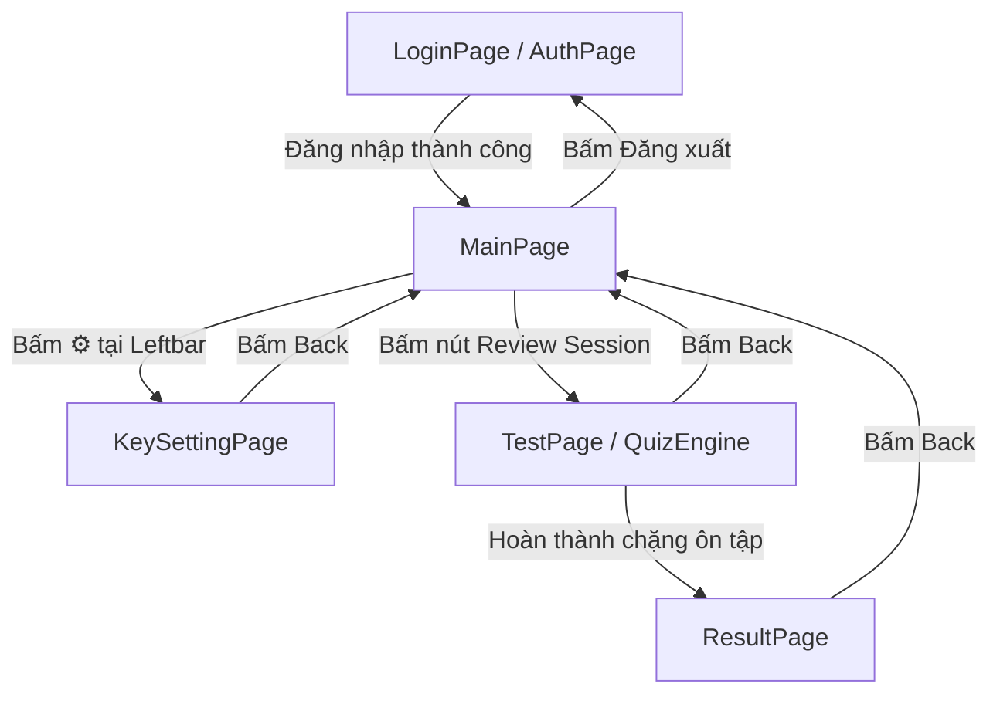
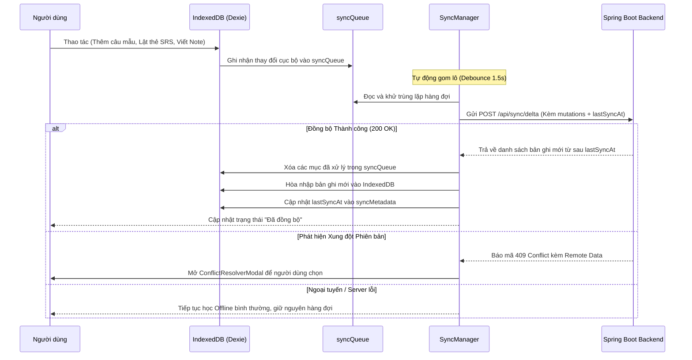

# TÀI LIỆU YÊU CẦU NGHIỆP VỤ PHẦN MỀM (BRD) - FRONTEND

## Hệ Thống Học Từ Vựng Tiếng Anh Ghi Chú Thông Minh (Smart English Notes)

| Thông tin tài liệu     | Chi tiết                                                                               |
| :--------------------- | :------------------------------------------------------------------------------------- |
| **Dự án**              | Smart English Notes (Web Client)                                                       |
| **Đối tượng áp dụng**  | Ứng dụng Frontend (Next.js 16 / React 19 / TypeScript / Tailwind CSS)                  |
| **Phiên bản tài liệu** | **v1.2.0** (Nâng cấp Đa Ngữ Cảnh, Ôn tập Theo Chặng, Tối ưu Read-First & UI Editorial) |
| **Ngày cập nhật**      | 2026-10-16                                                                             |
| **Lưu trữ**            | `learning_english_fe/docs/brd.md`                                                      |

---

## 1. Tổng quan & Triết lý Thiết kế Nâng cấp

Ứng dụng **Smart English Notes** là nền tảng học tập từ vựng tiếng Anh kết hợp giữa quy trình viết bài đọc (Notion-style note taking) với trí tuệ nhân tạo (AI) và phương pháp học lặp lại ngắt quãng (Spaced Repetition System - SRS).

### Các Trọng tâm Kiến trúc & Triết lý Thiết kế Nâng cấp (v1.2.0):

1. **Offline-First & Read-First Performance**:
   - Toàn bộ dữ liệu chủ đề, bài viết, từ vựng và câu mẫu được lưu trữ trực tiếp trên trình duyệt qua **IndexedDB (Dexie.js)**.
   - Thao tác đọc dữ liệu hàng ngày (lấy bài ôn tập hôm nay, mở bài viết) phản hồi tức thì (`< 10ms`) không phụ thuộc vào mạng.
2. **Học Từ Vựng Đa Ngữ Cảnh (Multi-Context Learning)**:
   - Loại bỏ cơ chế nhân bản thẻ flashcard khi gặp lại từ cũ. Một từ vựng cá nhân (`UserWord`) có thể tích lũy **nhiều câu ví dụ/ngữ cảnh (`WordContext`)** từ nhiều bài `Note` khác nhau của người dùng.
3. **Trải nghiệm Ôn tập Nhân văn (Paced & Humane SRS)**:
   - Thay vì đổ dồn hàng trăm từ quá hạn gây áp lực, hệ thống chia nhỏ thành các **chặng học ngắn (15–20 thẻ/phiên)** với hiệu ứng hoàn thành khích lệ (Micro-Victory).
4. **AI Dịch thuật Ngữ cảnh & Chẩn đoán Lỗi Thông minh**:
   - Bôi đen từ vựng sẽ trích xuất kèm cả câu văn trong bài Note gửi cho AI để dịch sát ngữ cảnh.
   - Chế độ kiểm tra điền từ chính tả có AI phân tích lỗi typo gõ phím nhỏ và tha thứ cho các từ đồng nghĩa hợp lý.
5. **Thẩm mỹ Thủ công (Human-Crafted & Editorial Minimalism)**:
   - Loại bỏ phong cách "Dark mode Slate công nghiệp generic". Áp dụng ngôn ngữ thiết kế tạp chí giấy ngà ấm áp (**Paper Warm `#FBFBFA`**) kết hợp đá Obsidian (**`#111215`**), đường viền siêu mảnh `1px hairline`, và font Serif thanh lịch cho từ vựng.

---

## 2. Bản Đồ Cấu Trúc Tabs & Luồng Điều Hướng

Ứng dụng được thiết kế theo dạng **Single Page Application (SPA)** điều hướng tập trung qua biến trạng thái `activeView` tại `app/page.tsx`:

---

## 3. Đặc Tả Chức Năng Chi Tiết Các Màn Hình (Views & Components)

### 3.1. Trang Xác thực (LoginPage / AuthPage)

- **Bố cục**: Căn giữa màn hình tối giản, card nổi nhẹ trên nền giấy ngà/than chì mờ.
- **Chức năng**:
  - Chế độ **Sign In**: Username + Password.
  - Chế độ **Sign Up**: Username + Email + Password.
  - Lưu trữ phiên: Lưu JWT token, vai trò, và username vào `localStorage`.

---

### 3.2. Không Gian Làm Việc Chính (MainPage)

#### A. Thanh Trạng Thái & Điều Hướng (DashboardCounters)

- **Bố cục**: Thanh ngang mỏng thanh lịch (`h-14`), viền dưới sợi tóc `border-hairline`.
- **Thành phần & Chức năng**:
  - **Brand Logo**: Biểu tượng Sparkles thanh mảnh.
  - **Chỉ báo Sync Yên Tĩnh**: Thay vì icon quay giật, hiển thị nhãn nhẹ: `Đã lưu cục bộ • Đồng bộ đám mây 2m trước` (hoặc `Offline Mode`).
  - **Bộ đếm Thống kê**:
    - `Today's Reviewed`: Số thẻ từ đã ôn tập hôm nay (chấm xanh lá khi đạt chỉ tiêu).
    - `Total Vocabulary`: Tổng số từ vựng cá nhân tích lũy.
  - **Bộ chuyển Tab chính**:
    - Tab 1: **Word Editor** (Mở trình soạn thảo bài viết).
    - Tab 2: **Review Session** (Mở phiên ôn tập thẻ từ, kèm badge số từ đến hạn `[15 due]`).

#### B. Thanh Thư Mục & Ngữ Cảnh (Leftbar)

- **Bố cục**: Cột bên trái (`w-60`), nền chìm `surface-subtle`, viền phải siêu mỏng.
- **Thành phần & Chức năng**:
  - **Cây Thư mục Chủ đề (`Topics`)**: Thêm mới, đổi tên, xóa chủ đề; thu gọn/mở rộng cây thư mục.
  - **Danh sách Bài viết (`Notes`)**:
    - Hiển thị danh sách tiêu đề bài viết thuộc Topic được chọn.
    - Kèm **Huy hiệu số từ (Harvested Badge)**: Hiển thị số lượng từ vựng đã trích xuất từ bài viết đó (ví dụ: `8`).
  - **Khu vực Cá nhân (Footer)**:
    - Tên người dùng, nút cấu hình AI (⚙️), nút chuyển theme Sáng/Tối.
    - **Đăng xuất Êm Ái (Smooth Logout)**: Mở hộp thoại xác nhận nhẹ nhàng, xóa sạch IndexedDB và Token, chuyển mượt về `LoginPage` mà không reload trang.

#### C. Trình Soạn Thảo Đa Ngữ Cảnh (NotionEditor)

- **Bố cục**: Trang giấy soạn thảo tối đa `max-w-3xl` căn giữa thoáng đãng.
- **Chức năng**:
  - Soạn thảo tiêu đề bài viết và nội dung chi tiết.
  - **Highlight Vĩnh Viễn**: Các từ vựng đã từng lưu trong bài viết được gạch chân chấm thanh nhã (`dashed underline`). Di chuột qua từ sẽ hiện tooltip nghĩa nhanh.
  - **Dịch AI Bóc Tách Ngữ Cảnh & Nhận Diện Từ Cũ**:
    1. Khi người dùng bôi đen 1 từ: Hệ thống tự động trích xuất **từ được chọn VÀ cả câu văn chứa từ đó trong Note**.
    2. **Nếu từ ĐÃ TỒN TẠI trong kho của User**: Popover thông báo: _"Bạn đã lưu từ này ở bài 'Topic X'. Nghĩa: Sự đàm phán"_. Kèm nút: **"Thêm câu này làm câu mẫu #2"** (tích lũy ngữ cảnh, không nhân bản thẻ).
    3. **Nếu từ MỚI**: Gọi AI dịch ngữ cảnh $\rightarrow$ Hiển thị Popover xem trước: Từ, IPA, Loại từ, Nghĩa tiếng Việt, Câu ví dụ gốc trong Note, Dịch câu ví dụ.
    4. **Cho phép Chỉnh sửa trước khi Lưu**: Người dùng có thể click đúp sửa lại nghĩa dịch bằng tay theo ý mình trước khi nhấn **Save Card**.

---

### 3.3. Phòng Luyện Tập & Ôn Bài (TestPage / QuizEngine)

- **Thiết kế**: Tập trung cao độ (Distraction-free), không gian tĩnh lặng.
- **Quy trình Ôn tập**:
  1. **Chia Chặng Học Nhỏ (Paced Sessions)**:
     - Truy vấn từ vựng đến hạn (`nextReviewAt <= today`).
     - Chia thành từng đợt vừa sức (mặc định: **15–20 thẻ/chặng**). Hiển thị tiến trình: `Thẻ 7 / 15`.
  2. **Chế độ Thẻ Flashcard 3D Xúc Giác**:
     - Mặt trước: Từ vựng font Serif cỡ lớn + Nút loa phát âm TTS.
     - Hiệu ứng lật 3D không gian mượt mà.
     - Mặt sau: Nghĩa, IPA, câu ví dụ trích từ Note. Nếu từ có nhiều câu ví dụ, hệ thống xoay vòng ngẫu nhiên câu mẫu để người học không bị học vẹt.
     - Hỗ trợ đầy đủ phím tắt: `[Space]` để lật, `[1]` để chọn **Forgot**, `[2]` để chọn **Remembered**.
  3. **Chế độ Điền từ Chính tả / Đặt câu (AI Diagnostic Essay Mode)**:
     - Hiển thị câu ví dụ khuyết từ (`___`). Người dùng gõ từ vào ô input.
     - **Chẩn đoán Lỗi AI**:
       - Khớp 100%: Tính điểm tối đa.
       - Lỗi gõ phím nhỏ (Typo thiếu 1 chữ): Thông báo tha thứ lỗi gõ phím, vẫn tính điểm đạt.
       - Gõ từ đồng nghĩa hợp lý: AI giải thích từ vừa gõ đúng ngữ pháp và gợi ý từ gốc trong thẻ.
  4. **Màn hình Micro-Victory**:
     - Khi hoàn thành 15 thẻ $\rightarrow$ Hiển thị tóm tắt kết quả chặng, khích lệ người học kèm 2 nút: **"Ôn tiếp 15 thẻ nữa"** hoặc **"Xem kết quả tổng kết"**.

---

### 3.4. Báo Cáo Kết Quả & Tra Cứu Kho Từ Vựng (ResultPage)

- **Bento Grid Thống Kê Chuẩn Xác**:
  - Tách bạch rõ ràng: **Số từ mới nạp hôm nay** vs **Số lượt thẻ đã ôn tập hôm nay**.
  - Tỷ lệ trả lời đúng (% Accuracy) và chuỗi ngày học liên tục (Streak Calendar).
  - Biểu đồ tỷ lệ kho từ: Mastered (Xanh lá) - Learning (Vàng) - New (Iris).
- **Bảng Tra Cứu Kho Từ Vựng Đa Ngữ Cảnh**:
  - Tìm kiếm từ vựng, lọc theo Trạng thái (`NEW`, `LEARNING`, `MASTERED`).
  - Cột hiển thị số lượng câu mẫu (ví dụ: `2 câu ví dụ`), click vào mở rộng xem danh sách các câu mẫu và tên bài Note liên kết.

---

### 3.5. Trang Cấu Hình Khóa AI (KeySettingPage)

- Người dùng tự nhập API Key cá nhân (**DeepSeek** hoặc **Google Gemini**).
- Nút **Test Connection**: Kiểm tra tính hợp lệ của key và tự động tải danh sách Model mới nhất từ nhà cung cấp.
- 2 Dropdown độc lập: Model dịch thuật bài viết và Model chấm bài tập chính tả.

---

### 3.6. Hộp Thoại Giải Quyết Xung Đột (ConflictResolverModal)

- Xuất hiện khi phát hiện xung đột phiên bản lúc đồng bộ đám mây.
- Bảng so sánh 2 cột trực quan: **Bản thiết bị này (Local)** vs **Bản trên máy chủ (Cloud)**. Người dùng tự chọn bản muốn giữ lại.

---

## 4. Kiến Trúc Dữ Liệu Cục Bộ (IndexedDB Schema - Dexie.js)

Hệ thống lưu trữ cục bộ được mở rộng để hỗ trợ đa ngữ cảnh và đồng bộ vi sai (Delta Sync):

| Tên Bảng       | Khóa Chính     | Chỉ Mục (Indexes) & Thuộc Tính            | Mô Tả Nghiệp Vụ                                       |
| :------------- | :------------- | :---------------------------------------- | :---------------------------------------------------- |
| `topics`       | `id` (UUID)    | `name, updatedAtMs`                       | Thư mục chủ đề                                        |
| `notes`        | `id` (UUID)    | `topicId, title, updatedAtMs`             | Bài viết ghi chú tiếng Anh                            |
| `words`        | `id` (UUID)    | `text, status, nextReviewAt, updatedAtMs` | Từ vựng cá nhân & thông số SRS                        |
| `wordContexts` | `id` (UUID)    | `wordId, noteId, updatedAtMs`             | Danh sách câu ví dụ & bản dịch gắn với từng Note      |
| `reviewLogs`   | `id` (Auto)    | `wordId, reviewedAtMs, isCorrect`         | Lịch sử các lần lật thẻ / điền từ để tổng hợp báo cáo |
| `syncQueue`    | `id` (Auto)    | `entityType, entityId, action, timestamp` | Hàng đợi các thay đổi cần đồng bộ lên server          |
| `syncMetadata` | `key` (String) | `value`                                   | Lưu `lastSyncAt`, `streakDays`, `wordsHarvestedToday` |

---

## 5. Quy Trình Đồng Bộ Vi Sai (Delta Sync Process)

---

## 6. Yêu Cầu Phi Chức Năng (NFRs)

1. **Tốc độ Phản hồi Giao diện (Instant UI Response)**:
   - Chuyển giữa các bài Note và mở phiên Review diễn ra trong **`< 10ms`** (đọc từ IndexedDB).
   - Lật thẻ Flashcard phản hồi trong **`< 16ms`** (đạt chuẩn 60fps mượt mà).
2. **Khả năng Hoạt động Ngoại tuyến (Offline Autonomy)**:
   - Toàn bộ thao tác đọc ghi chú, tra cứu từ vựng và ôn tập Flashcard hoạt động 100% khi mất mạng.
3. **Tiết kiệm Băng thông (Delta Payload)**:
   - Chỉ gửi và nhận các bản ghi thay đổi từ sau mốc `lastSyncAt`, chấm dứt việc xóa trắng và tải lại toàn bộ DB.
4. **Bảo mật API Key**:
   - API Key người dùng lưu trong DB backend dưới dạng mã hóa AES-256; tải xuống RAM frontend qua Closure Pattern, không lưu plaintext ở LocalStorage.
