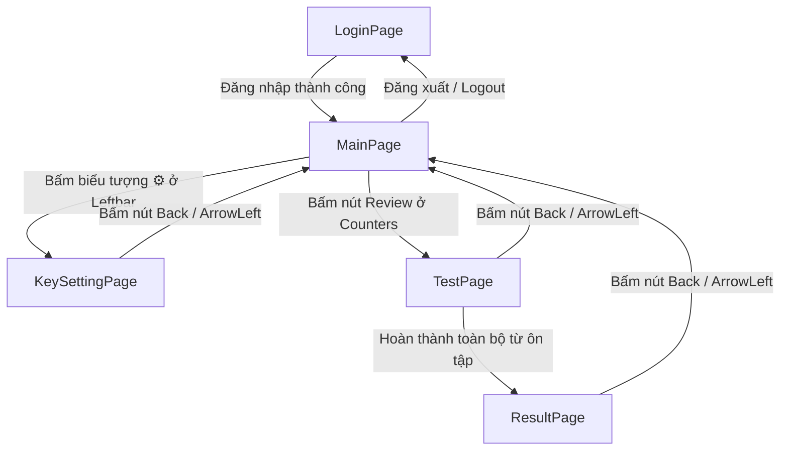
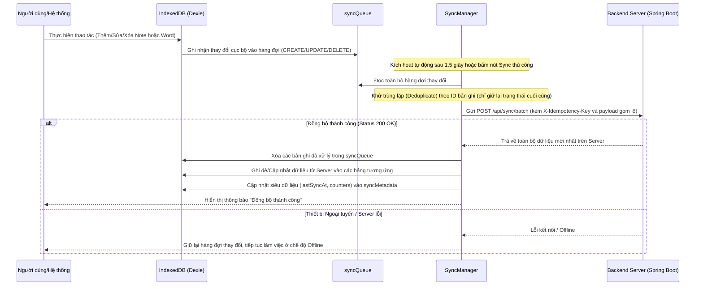

# TÀI LIỆU YÊU CẦU NGHIỆP VỤ PHẦN MỀM (BRD) - FRONTEND

| Thông tin tài liệu | Chi tiết |
| --- | --- |
| **Dự án** | Hệ Thống Học Từ Vựng Tiếng Anh Ghi Chú Thông Minh (Smart English Notes) |
| **Đối tượng áp dụng** | Ứng dụng Frontend (Next.js / TypeScript) |
| **Phiên bản tài liệu** | v1.1.0 |
| **Ngôn ngữ** | Tiếng Việt (Vietnamese) |
| **Lưu trữ** | `frontend/docs/brd.md` |

---

## 1. Tổng quan Dự án

Ứng dụng **Smart English Notes** là giải pháp học tập từ vựng tiếng Anh đột phá, tích hợp trực tiếp quy trình viết ghi chú (Notion-style note taking) với trí tuệ nhân tạo (AI) và phương pháp học lặp lại ngắt quãng (Spaced Repetition). 

Người dùng có thể đọc các bài báo, bài viết tiếng Anh, trực tiếp ghi chép lại trên hệ thống, bôi đen dịch nghĩa các từ vựng mới bằng AI, tự động tạo flashcards và thực hiện kiểm tra từ vựng hàng ngày (gồm lật thẻ và gõ chính tả sửa lỗi ngữ pháp nâng cao).

### Các Trọng tâm Kiến trúc & Triết lý Thiết kế:
* **Offline-First (Ưu tiên ngoại tuyến)**: Mọi dữ liệu như chủ đề (Topics), ghi chú (Notes), từ vựng (Words) và trạng thái học tập đều được lưu trữ trực tiếp trên trình duyệt bằng cơ sở dữ liệu **IndexedDB (thông qua Dexie.js)**. Ứng dụng hoạt động mượt mà kể cả khi ngắt kết nối mạng hoàn toàn.
* **Client-side AI (LangChain.js)**: Việc tích hợp AI được thực hiện trực tiếp từ Frontend thông qua thư viện **LangChain.js** và API Key do người dùng tự cung cấp (DeepSeek hoặc Google Gemini). Không chạy trung gian qua server ứng dụng giúp giảm tải hạ tầng và tăng tốc độ xử lý.
* **Bảo mật Phiên làm việc & API Key tối đa**: API Key được lưu trữ dưới dạng mã hóa AES-256 ở database Backend. Khi tải xuống Frontend, Key được giải mã và chỉ lưu trữ duy nhất trong bộ nhớ RAM tạm thời của trình duyệt bằng cơ chế **Closure Pattern** (mô hình đóng gói), tránh nguy cơ bị hack đánh cắp qua mã độc XSS hoặc lưu trữ không an toàn ở LocalStorage/Cookie.
* **Đồng bộ hóa Không đồng bộ (Async Batch Sync)**: Ứng dụng tự động theo dõi các thay đổi và ghi nhận vào một hàng đợi ngoại tuyến (`syncQueue`). Khi phát hiện có kết nối mạng, hệ thống sẽ thực hiện đồng bộ gom lô (Batch) lên server Spring Boot để cập nhật trạng thái đồng bộ hóa trên mọi thiết bị.

---

## 2. Luồng Người dùng & Điều hướng (User Navigation Flow)

Ứng dụng được thiết kế theo dạng **Single Page Application (SPA)**. Trạng thái điều hướng được quản lý tập trung thông qua biến trạng thái `activeView` tại `app/page.tsx`.

Dưới đây là sơ đồ luồng chuyển đổi giữa các màn hình chính (Views):



---

## 3. Danh sách Chi tiết các Trang (Views) & Chức năng

### 3.1. Trang Đăng nhập & Đăng ký (LoginPage)
* **Đường dẫn tệp**: [LoginPage.tsx](file:///Users/kieuhieu2/Desktop/learning%20english/frontend/app/views/LoginPage.tsx) (Sử dụng [AuthPage.tsx](file:///Users/kieuhieu2/Desktop/learning%20english/frontend/components/AuthPage.tsx))
* **Giao diện trực quan**:
  * Phong cách Dark Mode tối giản, hiện đại (nền `bg-slate-950` kết hợp border mỏng `border-slate-800`).
  * Form căn giữa màn hình với hiệu ứng kính mờ (Backdrop blur) và các biểu tượng trực quan từ thư viện `lucide-react`.
* **Chức năng nghiệp vụ**:
  * **Chế độ Đăng nhập (Sign In)**: Xác thực bằng `Username` và `Password`. Gọi API đăng nhập để lấy JWT Token.
  * **Chế độ Đăng ký (Sign Up)**: Đăng ký tài khoản mới gồm các thông tin: `Username`, `Email`, `Password`, và xác nhận mật khẩu `Confirm Password`.
  * **Lưu thông tin phiên**: Đăng nhập thành công sẽ lưu `jwt_token`, `username`, và `user_role` vào `localStorage`.
* **Ràng buộc dữ liệu & Xử lý lỗi**:
  * Kiểm tra trống các trường, xác thực email đúng định dạng.
  * Đăng ký yêu cầu mật khẩu khớp với mật khẩu xác nhận.
  * Hiển thị thông báo lỗi chi tiết dạng Alert Box màu đỏ nếu thông tin đăng nhập sai hoặc server backend không phản hồi.

---

### 3.2. Trang Chủ & Soạn thảo (MainPage)
* **Đường dẫn tệp**: [MainPage.tsx](file:///Users/kieuhieu2/Desktop/learning%20english/frontend/app/views/MainPage.tsx)
* **Giao diện trực quan**: Chia thành bố cục 3 phần chính (3-Column/Section Layout):
  1. **Thanh điều hướng bên trái (Leftbar)**: Quản lý thư mục chủ đề.
  2. **Thanh thống kê trên cùng (DashboardCounters)**: Hiển thị tiến trình học tập của ngày hiện tại.
  3. **Vùng làm việc trung tâm (NotionEditor)**: Trình soạn thảo văn bản ghi chú.
* **Chức năng nghiệp vụ chi tiết của các Component con**:

#### A. Thanh điều hướng bên trái (Leftbar)
* **Đường dẫn tệp**: [Leftbar.tsx](file:///Users/kieuhieu2/Desktop/learning%20english/frontend/components/Leftbar.tsx)
* **Chức năng**:
  * **Danh sách Chủ đề (Topics)**: Hiển thị cây thư mục các chủ đề. Cho phép thêm mới chủ đề bằng ô nhập nhanh, xóa chủ đề hiện có.
  * **Danh sách Ghi chú (Notes)**: Nhấp vào chủ đề sẽ hiển thị danh sách các bài viết ghi chú trực thuộc. Cho phép tạo bài viết mới trong chủ đề được chọn hoặc xóa bài viết.
  * **Quản lý tài khoản**: Hiển thị tên người dùng đang đăng nhập và nút Đăng xuất (Logout).
  * **Nút Cấu hình AI (⚙️)**: Điều hướng sang trang `KeySettingPage` để người dùng quản lý API key của họ.
  * **Cơ chế Đăng xuất bảo mật**: Khi người dùng nhấn Đăng xuất, ứng dụng sẽ thực hiện xóa hoàn toàn thông tin Token trong `localStorage` và **xóa sạch cơ sở dữ liệu IndexedDB** (`Dexie.delete()`) để tránh việc rò rỉ dữ liệu chéo giữa các tài khoản đăng nhập trên cùng một thiết bị.

#### B. Thanh thống kê & Đồng bộ (DashboardCounters)
* **Đường dẫn tệp**: [DashboardCounters.tsx](file:///Users/kieuhieu2/Desktop/learning%20english/frontend/components/DashboardCounters.tsx)
* **Chức năng**:
  * **Thống kê nhanh**:
    * Số từ đã ôn tập hôm nay (Today's Reviewed).
    * Tổng số từ vựng hiện có trong kho dữ liệu cá nhân (Total Vocabulary).
  * **Nút Ôn tập nhanh (Review)**: Nếu có từ vựng đến hạn ôn tập (Due words), nút sẽ sáng lên màu Indigo kèm hiệu ứng thông báo số lượng từ cần ôn tập. Khi bấm vào sẽ dẫn sang `TestPage`.
  * **Trạng thái Đồng bộ hóa**: Hiển thị nhãn kết nối và trạng thái đồng bộ hóa (Đã đồng bộ / Đang đồng bộ / Chế độ ngoại tuyến). Hỗ trợ nút kích hoạt đồng bộ hóa thủ công bằng tay.

#### C. Trình soạn thảo thông minh (NotionEditor)
* **Đường dẫn tệp**: [NotionEditor.tsx](file:///Users/kieuhieu2/Desktop/learning%20english/frontend/components/NotionEditor.tsx)
* **Chức năng**:
  * Soạn thảo tiêu đề bài viết ghi chú và nội dung chi tiết. Tự động lưu nội dung ghi chú xuống IndexedDB và xếp hàng đồng bộ hóa sau mỗi thay đổi nhỏ.
  * **Dịch từ vựng qua AI**:
    * Khi người dùng bôi đen (select) một từ hoặc cụm từ tiếng Anh trong khung soạn thảo, một thanh công cụ popover nhỏ với nút **"Translate with AI"** (hoặc biểu tượng Sparkles ✦) sẽ xuất hiện phía trên con trỏ chuột.
    * Khi nhấn nút, ứng dụng gọi thư viện LangChain sử dụng API key được cấu hình để gửi prompt dịch từ vựng.
    * **Prompt AI quy định định dạng đầu ra chuẩn JSON**:
      ```json
      {
        "text": "từ_tiếng_anh",
        "translation": "nghĩa_tiếng_việt",
        "partOfSpeech": "loại_từ",
        "ipa": "phiên_âm_ipa",
        "exampleContext": "câu_ví_dụ_tiếng_anh",
        "exampleTranslation": "bản_dịch_câu_ví_dụ_tiếng_việt"
      }
      ```
    * Cửa sổ hiển thị kết quả dịch thuật (Word card popover) sẽ xuất hiện với thông tin chi tiết. Người dùng có thể chỉnh sửa lại nghĩa dịch bằng tay nếu muốn trước khi bấm lưu.
    * Khi bấm Lưu, từ vựng này sẽ tự động được thêm vào bảng `words` của IndexedDB với liên kết khóa ngoại `noteId`, mặc định trạng thái ban đầu là `NEW`.

#### D. Hộp thoại Giải quyết Xung đột (ConflictResolverModal)
* **Đường dẫn tệp**: [ConflictResolverModal.tsx](file:///Users/kieuhieu2/Desktop/learning%20english/frontend/components/ConflictResolverModal.tsx)
* **Chức năng**:
  * Xuất hiện khi cơ chế đồng bộ hóa phát hiện phiên bản của Note/Word trên máy chủ (Remote Version) có sự sai khác về số phiên bản (`version`) so với bản ghi cục bộ (Local Version).
  * Hiển thị bảng so sánh song song trực quan nội dung giữa bản cục bộ và bản trên đám mây để người dùng lựa chọn:
    * **Keep My Local Version**: Giữ lại thay đổi của thiết bị hiện tại, ghi đè lên máy chủ trong chu kỳ đồng bộ tiếp theo.
    * **Apply Cloud Version**: Chấp nhận dữ liệu trên đám mây, cập nhật ghi đè vào IndexedDB cục bộ.

---

### 3.3. Trang Cấu hình Khóa AI (KeySettingPage)
* **Đường dẫn tệp**: [KeySettingPage.tsx](file:///Users/kieuhieu2/Desktop/learning%20english/frontend/app/views/KeySettingPage.tsx)
* **Giao diện trực quan**:
  * Thiết kế trang cấu hình toàn màn hình cao cấp, có nút quay lại MainPage độc lập ở góc trái.
  * Các nút bấm, khung viền sử dụng gradient màu chuyển sắc đặc trưng của từng nhà cung cấp.
* **Chức năng nghiệp vụ**:
  * **Chọn Nhà cung cấp AI (AI Provider)**:
    * **DeepSeek**: Sử dụng API OpenAI-compatible endpoint. Thẻ chọn có viền phát sáng màu xanh cyan huyền bí.
    * **Google Gemini**: Sử dụng Google AI Studio. Thẻ chọn có viền phát sáng màu tím/hồng sang trọng.
  * **Nhập API Key**: Ô nhập mật khẩu bảo mật (có nút mắt 👁 để ẩn/hiện khóa).
  * **Kiểm tra kết nối (Test Connection)**:
    * Khi người dùng nhấn nút, ứng dụng gọi trực tiếp API danh sách model của nhà cung cấp đã chọn (vượt qua server ứng dụng) để xác nhận key hợp lệ:
      * *DeepSeek*: `GET https://api.deepseek.com/models`
      * *Gemini*: `GET https://generativelanguage.googleapis.com/v1beta/models?key=API_KEY`
    * Hiển thị trạng thái tải (Loading spinner), thông báo thành công (tích xanh) hoặc lỗi kết nối (X đỏ kèm chi tiết lỗi kỹ thuật).
  * **Lựa chọn Model thông minh**:
    * Khi kết nối thành công, hệ thống hiển thị danh sách các model khả dụng trong 2 dropdown lựa chọn:
      1. **Model Dịch thuật (Translation Model)**: Dành riêng cho dịch từ bôi đen trong NotionEditor.
      2. **Model Bài tập (Quiz Model)**: Dành cho chấm điểm tự luận chính tả trong TestPage.
  * **Lưu Cấu hình**:
    * Mã hóa API key và gửi lên server Backend thông qua phương thức `PUT /api/ai-settings` để lưu trữ an toàn trong DB.
    * Xóa sạch các cache settings cũ trong RAM client để cập nhật cấu hình mới.

---

### 3.4. Trang Luyện tập & Kiểm tra (TestPage)
* **Đường dẫn tệp**: [TestPage.tsx](file:///Users/kieuhieu2/Desktop/learning%20english/app/views/TestPage.tsx) (Sử dụng [QuizEngine.tsx](file:///Users/kieuhieu2/Desktop/learning%20english/frontend/components/QuizEngine.tsx))
* **Giao diện trực quan**: Thiết kế tập trung cao độ (Distraction-free), loại bỏ Leftbar để người học tập trung ôn tập từ vựng.
* **Chức năng nghiệp vụ**:
  * **Lọc từ vựng đến hạn (Due Words)**: Tự động truy vấn từ IndexedDB những từ vựng có ngày hẹn học tiếp theo nhỏ hơn hoặc bằng ngày hiện tại (`nextReviewAt <= today`).
  * **Hai chế độ Ôn tập**:
    1. **Chế độ Thẻ ghi nhớ (Flashcards - Mặc định)**:
       * Hiển thị từ vựng tiếng Anh. Cho phép bấm vào thẻ để lật ngược ra mặt sau xem nghĩa dịch tiếng Việt, IPA, loại từ và câu ví dụ cụ thể.
       * Hỗ trợ phát âm từ vựng (Text-to-Speech) sử dụng API phát âm của trình duyệt khi bấm biểu tượng Loa 🔊.
       * Cung cấp các nút tự đánh giá mức độ nhớ: **Forgot (Quên - quality 0-2)** hoặc **Remembered (Nhớ - quality 3-5)** để cập nhật thuật toán Spaced Repetition.
    2. **Chế độ Gõ chính tả (Spelling/Essay Test)**:
       * Hiển thị nghĩa tiếng Việt và câu ví dụ tiếng Anh bị khuyết từ vựng cần kiểm tra (được che bằng các dấu gạch dưới `_`).
       * Người dùng gõ câu trả lời vào ô input.
       * **Nếu khớp từ vựng**: Tính điểm tuyệt đối (quality = 5).
       * **Nếu không khớp hoàn toàn**: Gọi mô hình AI chấm điểm (sử dụng Model Bài tập được chọn ở KeySettingPage) để phân tích lỗi chính tả/ngữ pháp và đưa ra nhận xét phản hồi (Feedback) giải thích chi tiết lỗi sai cho người dùng.
  * **Thuật toán Spaced Repetition (SuperMemo-2)**:
    * Khi người dùng đánh giá mức độ nhớ/quên (phần chất lượng `quality` từ 0 đến 5):
      * Nếu trả lời đúng/nhớ bài (`quality >= 3`):
        * Chuỗi trả lời đúng liên tiếp: `correctStreak = correctStreak + 1`
        * Khoảng cách ôn tập tiếp theo (ngày): `intervalDays = Math.round(intervalDays * (1.5 + (5 - difficulty) * 0.1))`
      * Nếu trả lời sai/quên bài (`quality < 3`):
        * Reset chuỗi trả lời đúng liên tiếp: `correctStreak = 0`
        * Khoảng cách ôn tập tiếp theo (ngày): `intervalDays = 1` (học lại vào ngày mai)
        * Tăng độ khó từ vựng: `difficulty = Math.min(1.0, difficulty + 0.15)`
      * Trạng thái từ vựng: Nếu chuỗi trả lời đúng liên tiếp đạt từ 4 lần trở lên (`correctStreak >= 4`), trạng thái chuyển sang `MASTERED` (Đã thuộc lòng), ngược lại là `LEARNING` (Đang học).
      * Cập nhật ngày ôn tập tiếp theo: `nextReviewAt = today + intervalDays`

---

### 3.5. Trang Báo cáo Kết quả (ResultPage)
* **Đường dẫn tệp**: [ResultPage.tsx](file:///Users/kieuhieu2/Desktop/learning%20english/frontend/app/views/ResultPage.tsx)
* **Giao diện trực quan**:
  * Các biểu đồ thông tin thống kê tiến độ học dạng vòng tròn tỷ lệ phần trăm trực quan.
  * Danh sách từ vựng dạng bảng cuộn dễ tra cứu với các badge trạng thái nhiều màu sắc.
* **Chức năng nghiệp vụ**:
  * **Thống kê phiên học hôm nay**:
    * Tổng số lượng từ đã ôn tập trong ngày hiện tại.
    * Tỷ lệ phần trăm và số lượng câu trả lời đúng (Correct) / sai (Incorrect).
  * **Thống kê tổng quát kho từ vựng**:
    * Hiển thị số từ theo từng trạng thái bằng Badge màu:
      * **MASTERED**: Đã thuộc lòng (Màu xanh lá - `text-emerald-400`).
      * **LEARNING**: Đang học (Màu vàng - `text-amber-400`).
      * **NEW**: Từ mới được tạo chưa học (Màu xanh dương - `text-indigo-400`).
  * **Lọc & Tìm kiếm**: Bộ lọc nhanh cho phép lọc danh sách từ vựng hiển thị theo trạng thái học tập để người dùng dễ kiểm tra lại các từ bị sai nhiều.

---

## 4. Kiến trúc Luồng Dữ liệu & Đồng bộ Ngoại tuyến

### 4.1. Cơ sở dữ liệu Cục bộ (IndexedDB Schema - Dexie.js)

Dữ liệu cục bộ được tổ chức thành 5 bảng chính trong cơ sở dữ liệu `EnglishLearningOfflineDB`:

| Tên bảng | Khóa chính | Thuộc tính & Kiểu dữ liệu | Mô tả |
| --- | --- | --- | --- |
| `topics` | `id` (UUID) | `name` (String), `createdAtMs` (Number), `updatedAtMs` (Number) | Thư mục chủ đề chứa ghi chú |
| `notes` | `id` (UUID) | `topicId` (UUID/null), `title` (String), `content` (String), `version` (Number), `createdAtMs` (Number), `updatedAtMs` (Number) | Ghi chú dạng bài viết tiếng Anh |
| `words` | `id` (UUID) | `noteId` (UUID/null), `text` (String), `translation` (String), `partOfSpeech` (String), `ipa` (String), `exampleContext` (String), `exampleTranslation` (String), `status` (String), `correctStreak` (Number), `difficulty` (Number), `intervalDays` (Number), `nextReviewAt` (String - yyyy-MM-dd), `failedEssayStreak` (Number), `version` (Number), `createdAtMs` (Number), `updatedAtMs` (Number) | Kho từ vựng chi tiết liên kết với ghi chú |
| `syncQueue` | `id` (Auto-Increment) | `entityType` ('topic'\|'note'\|'word'), `entityId` (UUID), `action` ('CREATE'\|'UPDATE'\|'DELETE'), `payload` (JSON String), `timestamp` (Number) | Hàng đợi các thay đổi cần đồng bộ lên server |
| `syncMetadata` | `key` (String) | `value` (String) | Lưu trữ các biến hệ thống như `lastSyncAt`, `dailyWordCount`, `totalWordCount` |

### 4.2. Quy trình Đồng bộ hóa Dữ liệu (Batch Sync Process)

Để đảm bảo hiệu năng và tiết kiệm băng thông mạng, ứng dụng áp dụng quy trình đồng bộ hóa gom lô như sau:



---

## 5. Yêu cầu Bảo mật & Quản lý Phiên (Security & Session)

* **Vòng đời Token**: JWT Token được sinh ra từ backend khi đăng nhập thành công và lưu tại `localStorage`.
* **Xử lý Hết hạn Phiên / Quyền truy cập**:
  * Mọi yêu cầu HTTP gửi qua hàm bọc `apiFetch` đều được kiểm tra mã trạng thái trả về.
  * Nếu nhận về mã trạng thái **`401 Unauthorized`** hoặc **`403 Forbidden`**:
    1. Ứng dụng tiến hành xóa Token đăng nhập hiện tại trong `localStorage`.
    2. Đợi 5 giây để lưu log gỡ lỗi trên trình duyệt (trong môi trường phát triển).
    3. Thực hiện tải lại trang (`window.location.reload()`) để hệ thống tự động nhận diện mất phiên và điều hướng người dùng quay lại `LoginPage`.
* **Bảo vệ quyền riêng tư cục bộ (Privacy Isolation)**:
  * Khi người dùng thực hiện Đăng xuất (Logout) thủ công, ứng dụng ngay lập tức chạy lệnh xóa sạch IndexedDB cục bộ. Hành động này ngăn chặn việc tài khoản tiếp theo đăng nhập trên cùng thiết bị nhìn thấy dữ liệu học tập của tài khoản trước đó.

---

## 6. Yêu cầu Phi Kỹ thuật (Non-Functional Requirements)

* **Hiệu năng & Tốc độ phản hồi (Performance)**:
  * Vì dữ liệu được đọc trực tiếp từ IndexedDB cục bộ nên việc tải trang chính và chuyển hướng giữa các bài viết ghi chú phải diễn ra ngay lập tức (< 50ms) không phụ thuộc vào độ trễ của mạng Internet.
  * Thao tác bôi đen dịch từ vựng qua AI diễn ra bất đồng bộ, hiển thị vòng tròn tải nhẹ (Loading skeleton) để không gây đứng giao diện.
* **Độ tương thích (Compatibility)**:
  * Ứng dụng tương thích tốt với mọi trình duyệt hiện đại hỗ trợ IndexedDB (Google Chrome, Microsoft Edge, Mozilla Firefox, Safari).
  * Hỗ trợ thiết kế Responsive đáp ứng giao diện linh hoạt từ màn hình máy tính lớn đến các thiết bị di động cá nhân.
* **Thiết kế giao diện (UI/UX)**:
  * Nhất quán tông màu tối hiện đại (`slate-950` làm nền, `indigo-600` làm điểm nhấn accent).
  * Sử dụng chuyển cảnh mượt mà (transition duration 200ms) khi lật thẻ, hiển thị popover, hay mở các modal hội thoại.
